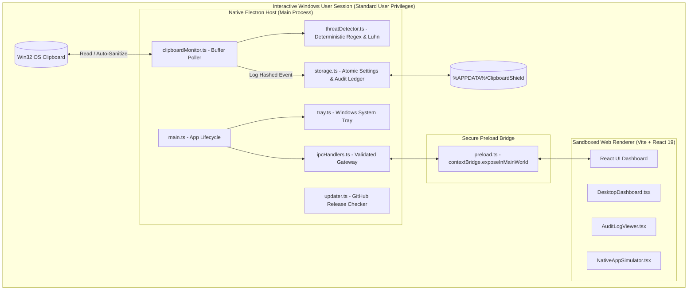
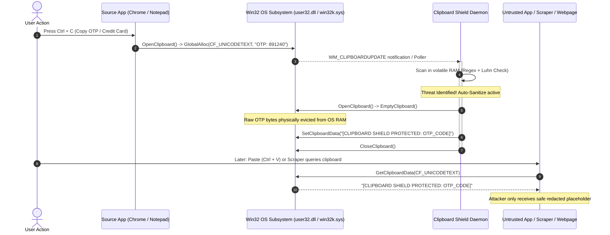
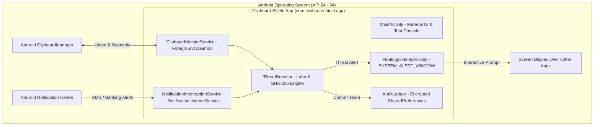

# Clipboard Shield — System Architecture & Threat Model

## 1. System Overview

Clipboard Shield is engineered as a genuine Windows desktop application that bridges real-time native operating system clipboard monitoring with an interactive, responsive security dashboard.

---

## 2. Windows Process Model & Privilege Boundaries

### Session Isolation & The "Windows Service" Myth
Under Windows architecture (Windows Vista through Windows 11), system services execute in **Session 0**, while interactive user desktops execute in **Session 1+** (`winsta0\default`). 

Because Session 0 is strictly isolated from interactive GUI sessions, a background Windows Service running as `NT AUTHORITY\SYSTEM`:
1. Cannot access the interactive user desktop's clipboard buffer directly without insecure workarounds.
2. Cannot display UI or system tray notifications.

Therefore, running a desktop process within the **interactive user session** with **standard user privileges** is the officially recommended, secure, and appropriate Windows architecture for clipboard security tools.

### Principle of Least Privilege
Clipboard Shield does **not** require Administrator elevation (`runas`), does not install unsigned kernel drivers, and does not inject arbitrary DLLs into third-party processes. It functions completely within standard user permissions.

---

## 3. Threat Model & Protection Guarantees

Clipboard Shield treats clipboard protection as a security-sensitive discipline with honest guarantees:

### 3.1 Win32 Memory Buffer Mechanics: Is Sanitization Superficial?

A common question is whether the auto-sanitization is merely a superficial UI-level mask or a physical operating-system-level eviction.

**Clipboard Shield physically overwrites the OS-level Win32 clipboard memory buffer.**

1. **Physical Deallocation:** When `EmptyClipboard()` is invoked by the daemon, Windows explicitly invalidates and frees the memory handles associated with previous clipboard formats (`CF_UNICODETEXT`, `CF_TEXT`).
2. **Buffer Replacement:** The daemon immediately allocates a new global memory block containing `[CLIPBOARD SHIELD PROTECTED: <CATEGORY>]`. Any application subsequently calling `GetClipboardData()` or browser `navigator.clipboard.readText()` receives only the redacted string.
3. **Volatile Evaluation Only:** Threat evaluation occurs strictly in transient, volatile heap memory. The raw sensitive text is deallocated immediately upon pattern evaluation.

---

### 3.2 Detailed Attack Vector Analysis

| Threat Vector | Clipboard Shield Defense | Security Boundary & Details |
| :--- | :--- | :--- |
| **Accidental Paste / Screenshare Leak** | 🛡️ **Fully Protected** | Overwrites the buffer within ~50ms. Pressing `Ctrl + V` in Slack, Discord, email, or a terminal pastes only the redacted placeholder. |
| **Malicious Webpage Clipboard Harvesting** | 🛡️ **Fully Protected** | Web APIs (`navigator.clipboard.readText()`) only read the sanitized placeholder when you switch tabs or click on a webpage. |
| **Background Info-Stealers & Spyware** | 🛡️ **Highly Mitigated** | Commodity malware (RedLine, Racoon, AgentTesla) periodically scans the clipboard buffer. Because the buffer is purged almost instantly, scrapers harvest only redacted placeholders. |
| **Cryptocurrency Address Hijackers (Clippers)** | 🛡️ **Fully Protected** | Detects Bitcoin (Legacy, SegWit, Bech32) and Ethereum addresses, preventing malware from swapping wallet addresses. |
| **Stolen Log Files / Disk Forensics** | 🛡️ **Zero Plaintext Guarantee** | Passwords and payment cards never touch disk. Only one-way cryptographic SHA-256 signatures and masked previews (`4111 •••• •••• 9021`) are logged. |
| **Sub-Millisecond Race Condition** | ⚠️ **Residual Risk** | If malicious software has an active Win32 clipboard format listener running in the same desktop session, it receives the update at the same time. The daemon overwrites within milliseconds, but pre-read hooks could observe the initial burst. |
| **Kernel Keyloggers (`WH_KEYBOARD_LL`)** | ❌ **Out of Scope** | Ring-0 rootkits and low-level keyboard hooks intercept keystrokes as physical keys are typed on the keyboard before the clipboard is involved. |
| **Process RAM Scraping (VirtualAlloc)** | ❌ **Out of Scope** | If an attacker has Administrator/SYSTEM access, they can dump the private virtual memory of the source application (e.g., Chrome's private DOM memory) directly. |

---

## 4. Native Android Architecture & Isolation

Clipboard Shield on Android operates under the Android Security Sandbox (Linux UID separation):

- **Foreground Daemon (`ClipboardMonitorService`):** Maintains a persistent low-priority status bar notification to prevent Android's OOM (Out-of-Memory) killer from terminating background protection.
- **Banking Notification Interception (`NotificationInterceptionService`):** Monitors banking SMS and UPI payment notifications (GPay, PhonePe, Paytm, HDFC, SBI, ICICI, OTPs).
- **Floating Overlay (`FloatingOverlayActivity`):** Uses `android.permission.SYSTEM_ALERT_WINDOW` to display an instant translucent authorization dialog on top of active banking applications with Approve and Block controls.
- **Zero Internet Requirement:** Pattern matching, Luhn verification, and SHA-256 audit ledger storage operate 100% on-device.

---

## 5. Storage & Offline Architecture

- **Path:** `%APPDATA%\ClipboardShield\` (e.g., `C:\Users\<User>\AppData\Roaming\ClipboardShield`).
- **Files:**
  - `settings.json`: User configuration (startup preference, auto-sanitize, retention).
  - `audit_ledger.json`: Immutable audit history containing timestamps, rule IDs, SHA-256 hashes, and masked previews.
- **Atomic File Writing:** Writes to `${filename}.tmp.${Date.now()}` and renames atomically, preventing file corruption during power outages or process termination.
- **Offline First:** Local monitoring, threat detection, and audit logging function 100% offline without remote API requirements.

---

## 6. Security & Privacy Hardening

| Security Measure | Implementation |
| :--- | :--- |
| **Context Isolation** | Enabled (`contextIsolation: true`). Renderer cannot access Node.js runtime. |
| **Renderer Sandbox** | Enabled (`sandbox: true`, `nodeIntegration: false`). |
| **Navigation Lockdown** | In-app navigation denied; all external links strictly opened via `shell.openExternal`. |
| **Telemetry Policy** | Zero telemetry or third-party analytical tracking. |
| **Credential Masking** | Passwords and payment card numbers are masked (`4111 •••• •••• 9021`) before UI render. |
| **Zero Plaintext Storage** | All events recorded exclusively with one-way SHA-256 cryptographic hashes. |
