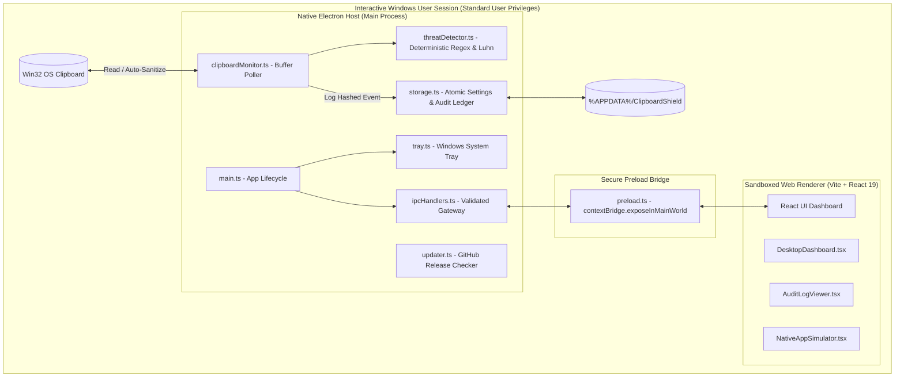

# Clipboard Shield — System Architecture & Threat Model

## 1. System Overview

Clipboard Shield is engineered as a genuine Windows desktop application that bridges real-time native operating system clipboard monitoring with an interactive, responsive security dashboard.

---

## 2. Windows Process Model & Privilege Boundaries

### Session Isolation & The "Windows Service" Myth
Under Windows architecture (Windows Vista through Windows 11), system services execute in **Session 0**, while interactive user desktops execute in **Session 1+** (`winsta0\default`). 

Because Session 0 is strictly isolated from interactive GUI sessions, a background Windows Service running as `NT AUTHORITY\SYSTEM`:
1. Cannot access the interactive user desktop's clipboard buffer directly without insecure workarounds.
2. Cannot display UI or system tray notifications.

Therefore, running a desktop process within the **interactive user session** with **standard user privileges** is the officially recommended, secure, and appropriate Windows architecture for clipboard security tools.

### Principle of Least Privilege
Clipboard Shield does **not** require Administrator elevation (`runas`), does not install unsigned kernel drivers, and does not inject arbitrary DLLs into third-party processes. It functions completely within standard user permissions.

---

## 3. Threat Model & Protection Guarantees

Clipboard Shield treats clipboard protection as a security-sensitive discipline with honest guarantees:

### What Clipboard Shield DOES Guarantee
1. **Real-Time Clipboard Monitoring:** Continuously evaluates clipboard buffer modifications across the desktop.
2. **Deterministic Pattern Interception:**
   - **Payment Cards:** Primary Account Numbers (Visa, Mastercard, Amex, Discover, RuPay) verified against the **Luhn algorithm (MOD-10)** to avoid false positives.
   - **Cloud Secrets & API Tokens:** Identifies AWS Access Keys (`AKIA...`), GitHub Personal Access Tokens (`ghp_...`), JWT bearer tokens, and OpenSSH/RSA Private Key blocks.
   - **Cryptocurrency Addresses:** Scans for Bitcoin (Legacy, SegWit, Bech32) and Ethereum / EVM-compatible hexadecimal wallet addresses.
   - **Financial Identifiers:** Identifies Indian UPI Virtual Payment Addresses (`...@okaxis`, etc.) and IBANs.
   - **Confidential OTPs:** Intercepts temporary 4-8 digit verification codes.
3. **Auto-Sanitization:** When enabled, immediately overwrites the clipboard buffer with a secure redacted placeholder `[CLIPBOARD SHIELD PROTECTED: <CATEGORY>]`, neutralising malicious clipboard paste attacks.
4. **Zero-Leak Cryptographic Audit Ledger:** Computes SHA-256 HMAC fingerprints of detected threats without logging raw plaintext passwords or credit card numbers to disk.
5. **Native OS Notifications:** Alerts the user immediately via Windows Action Center toast notifications.

### What Clipboard Shield CANNOT Guarantee (Threat Limitations)
1. **Synchronous Pre-Read Interception:** In Windows user mode, there is no synchronous callback before another process calls `GetClipboardData`. A malicious application that is actively polling or reading the clipboard at the exact microsecond an item is copied may observe the buffer before reactive sanitization completes.
2. **Malicious Kernel-Level Drivers / Memory Scrapers:** If an adversary has installed a kernel-level keylogger or rootkit, user-mode clipboard protection cannot prevent ring-0 memory inspection.

---

## 4. Storage & Offline Architecture

- **Path:** `%APPDATA%\ClipboardShield\` (e.g., `C:\Users\<User>\AppData\Roaming\ClipboardShield`).
- **Files:**
  - `settings.json`: User configuration (startup preference, auto-sanitize, retention).
  - `audit_ledger.json`: Immutable audit history containing timestamps, rule IDs, SHA-256 hashes, and masked previews.
- **Atomic File Writing:** Writes to `${filename}.tmp.${Date.now()}` and renames atomically, preventing file corruption during power outages or process termination.
- **Offline First:** Local monitoring, threat detection, and audit logging function 100% offline without remote API requirements.

---

## 5. Security & Privacy Hardening

| Security Measure | Implementation |
| :--- | :--- |
| **Context Isolation** | Enabled (`contextIsolation: true`). Renderer cannot access Node.js runtime. |
| **Renderer Sandbox** | Enabled (`sandbox: true`, `nodeIntegration: false`). |
| **Navigation Lockdown** | In-app navigation denied; all external links strictly opened via `shell.openExternal`. |
| **Telemetry Policy** | Zero telemetry or third-party analytical tracking. |
| **Credential Masking** | Passwords and payment card numbers are masked (`4111 •••• •••• 9021`) before UI render. |
